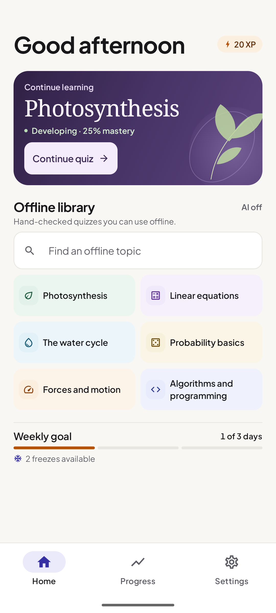
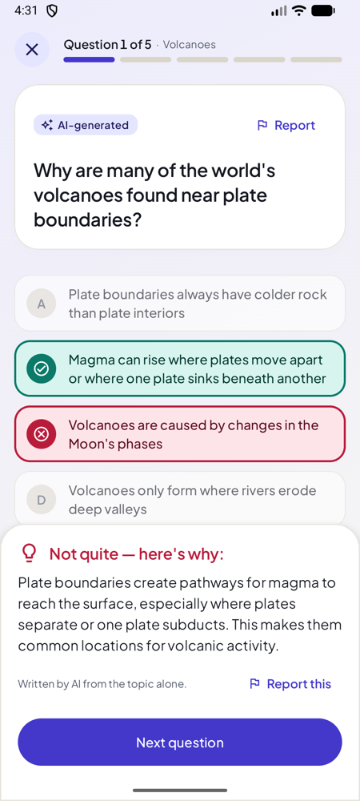
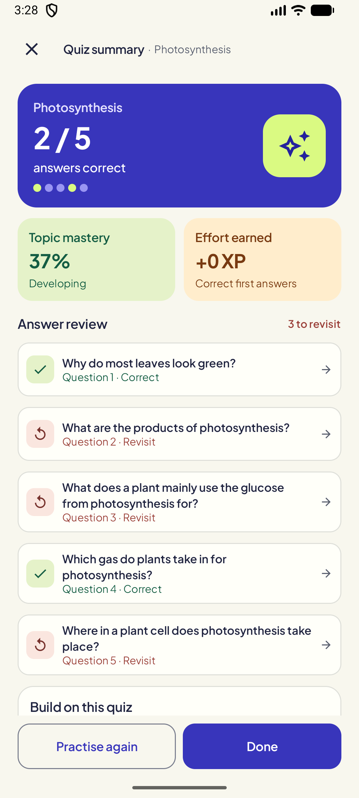
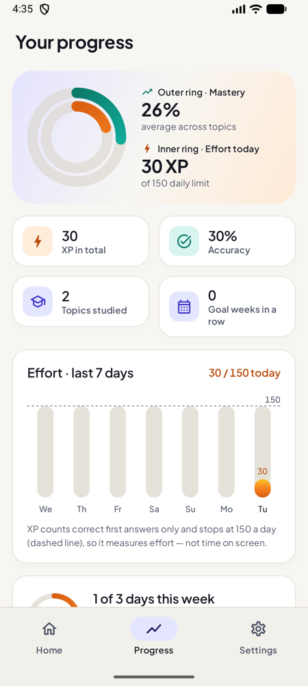
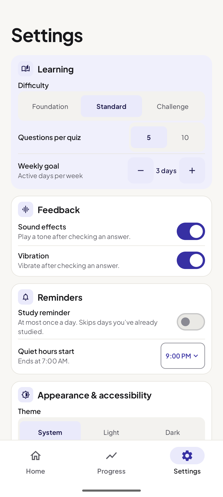
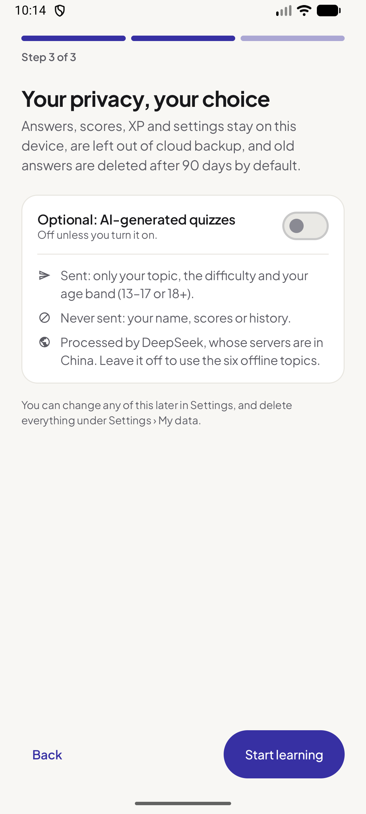
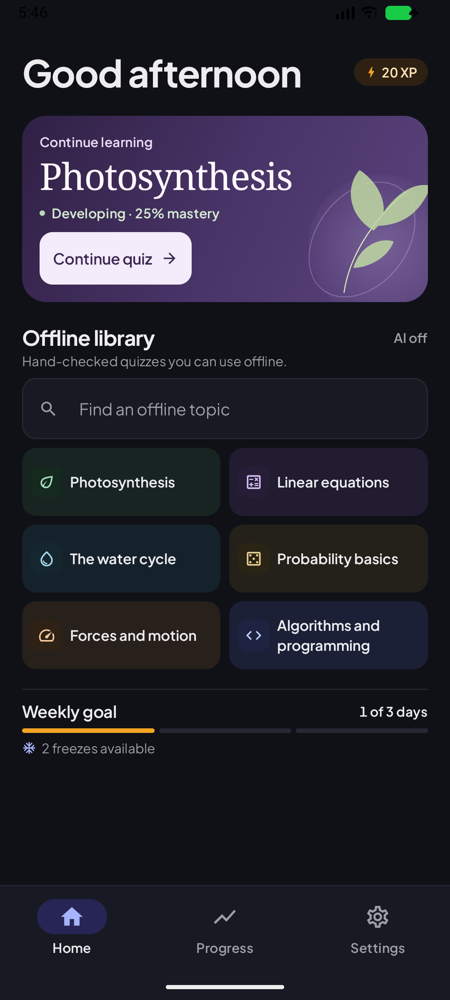
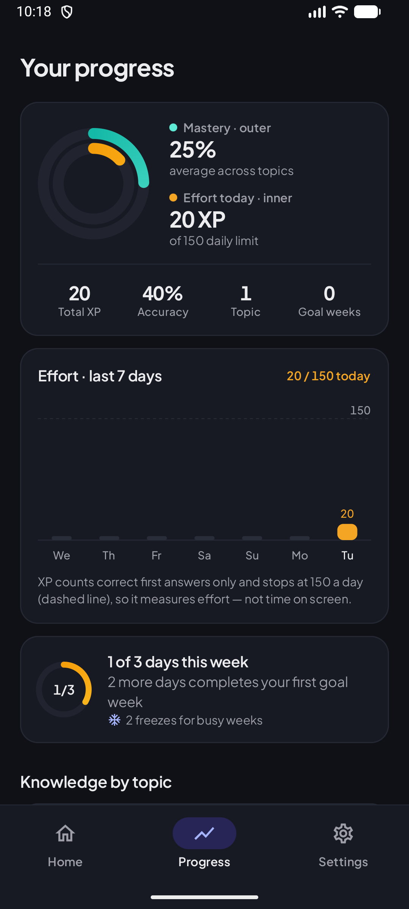

# Primoria for Android

**CP3406 Assessment 3 – Education App** · Kotlin · Jetpack Compose · Material 3 · Hilt · Room · Retrofit · Navigation · DataStore · WorkManager

Primoria is an ethics-first learning app for **secondary-school students and older learners (13+)**.
A learner types *any* topic, and Primoria builds a short multiple-choice quiz with clear explanations,
tracks what they actually know (mastery) separately from how much effort they put in (XP), and
keeps all learning data on the device.

It is the Android rebuild of the Primoria web project, designed around the six ethical commitments from my
CP3406 Assessment 2 presentation (*Designing for Trust: learner-data privacy and gamified engagement*).

| Home | Quiz | Feedback | Summary |
|---|---|---|---|
|  |  |  |  |

| Progress | Settings | My data | Onboarding consent (13–17) |
|---|---|---|---|
|  |  |  |  |

| Dark theme | Dark progress | Tablet (navigation rail) |
|---|---|---|
|  |  |  |

---

## Core features

| Screen | What it does |
|---|---|
| **Onboarding** (3 steps) | Welcome, age band (13–17 / 18+), and privacy choices. AI generation is **opt-in** and explained in plain language; learners aged 13–17 also confirm that a parent or guardian knows. |
| **Home** (landing) | "Continue learning" card with mastery level, a free-text topic box when AI is on (it becomes a search box for the offline library when AI is off), a compact six-topic **offline library**, a weekly-goal bar and a "today's XP" shortcut to Progress. |
| **Quiz** (activity) | 5 or 10 questions, A–D options, *Check answer* → correct/incorrect shown with **icon + text + colour**, an explanation, XP feedback, an **AI-generated** label and a **Report** action on every question, and a summary that shows **effort and mastery as separate cards**. |
| **Progress** (statistics) | Total XP, today's XP against the daily cap, a 7-day XP bar chart (with a spoken summary for TalkBack), weekly streak, overall accuracy and per-topic mastery (New → Developing → Secure → Mastered). |
| **Settings** | Difficulty, quiz length, weekly goal, sound and vibration, opt-in study reminder with quiet hours, theme (system/light/dark), larger text, AI on/off, age band, optional personal DeepSeek key. |
| **My data** | What is stored (counts), retention period (30 / 90 / 365 days), delete a single topic, or **delete everything** (which also resets onboarding). |

### How learning is measured
* **Mastery** — an exponential moving average per topic (`MasteryCalculator`). Harder questions move it further, and a wrong answer on a hard question costs less than on an easy one, so stretching is not punished. "Mastered" also needs at least 8 answers.
* **XP** — awarded **only for a correct first answer**, scaled by difficulty, and capped at **150 XP a day** (`XpPolicy`). Time spent, app opens and retries earn nothing.
* **Streaks** — count **weeks**, not days: a week counts when the learner studied on their chosen number of days. Two **streak freezes** can bridge missed weeks, and the current week never breaks a streak while it is in progress (`StreakCalculator`).

---

## Ethics in the implementation (from Assessment 2)

| # | A2 commitment | Where it lives in the code |
|---|---|---|
| 01 | **Local-first learner profile** | All history is in Room on the device; `allowBackup="false"` and `data_extraction_rules.xml` exclude it from cloud backup and device transfer; answers expire after the chosen retention period (`DataRetention`, applied on every launch). |
| 02 | **Just-in-time permissions** | The only runtime permission, `POST_NOTIFICATIONS`, is requested **only when the learner switches on study reminders** (`SettingsRoute`). If it is denied, reminders stay off and the app explains why. |
| 03 | **Honest AI** | Every question shows *AI-generated* or *Offline library*; AI explanations carry a note; any question can be **reported** and is then never served again (`content_reports` table, Room v1→v2 migration). DeepSeek may **refuse** unsuitable topics and the reason is shown instead of a quiz. |
| 04 | **Humane streaks** | Weekly goals with freezes, no countdown timers, no loss-framed copy, and an opt-in reminder that is sent **at most once a day, never in quiet hours (default 21:00–07:00), and not at all once the learner has studied today or met the week's goal** (`ReminderPolicy`). |
| 05 | **Reward learning, not screen time** | XP only for verified correct first answers with a daily cap; XP and mastery are always shown in separate cards; answer options are **shuffled** so the correct answer cannot be guessed by position. |
| 06 | **Learner control** | *My data* shows what is stored, lets the learner change retention, delete a topic or delete everything; the age-aware consent flow sets AI to **off** by default for everyone. |

**Data minimisation with DeepSeek.** The only data that leaves the device is the topic text, difficulty,
question count and age band (`QuizPrompt`). Before sending, `PersonalDataRedactor` removes e-mail addresses,
phone numbers and URLs a learner might type into the topic box. Scores, history, mastery and settings are never sent.

---

## Visual design

The interface uses a custom design system rather than default Material colours (see `ui/theme` and `ui/components`):

* **Colour roles with meaning.** A quiet "editorial" look: near-neutral paper background, white hairline cards with no stacked shadows, and a deep indigo used only for actions; a clean graphite dark theme. **Amber is only ever effort/XP** and **teal is only ever mastery**, so learners can tell showing up from understanding; correctness is never shown in the progress bar, and teal is never used for a wrong answer.
* **Typography.** Plus Jakarta Sans (SIL OFL, bundled in `res/font`, licence in `docs/licenses`) with a compact Material 3 type scale (hierarchy from weight and colour rather than size) and tabular numerals for XP, percentages and counters.
* **Signature components.** Subject tiles with a colour and glyph per subject family (`SubjectArt`), segmented question progress, a slide-up feedback sheet, one overview card with concentric mastery/effort rings, and a 7-day effort chart where empty days are short neutral stubs (never full-height tracks that read as "full").
* **Illustrations.** Four flat illustrations in the app palette (welcome, age band, loading, quiz summary), generated with OpenAI ImageGen via Codex and checked on light and dark backgrounds; stored as WebP in `res/drawable-nodpi`.
* **Motion.** Cards press to 0.97 with a soft spring, rings animate from their previous value, questions slide in; no confetti, timers or slot-machine effects.
* **Accessibility.** Feedback uses icon + words + colour; option results are exposed to TalkBack as state descriptions; charts and rings have spoken summaries; 48dp targets; a "Larger text" setting scales on top of the system font size.

The design system was drafted, then revised after a screenshot-based visual review (see *Acknowledgements*) and checked on phone, tablet, light and dark.

---

## Architecture

```
ui/ (Compose screens + ViewModels, one immutable StateFlow per screen)
 └─ depends on repository interfaces
data/
 ├─ repository/   LearningRepository · ProgressRepository · PrivacyRepository · OfflineLibrary
 ├─ local/        Room: entities, DAOs, type converters, PrimoriaDatabase (v2, exported schemas)
 ├─ remote/       Retrofit DeepSeekApi · QuizPrompt · QuizResponseParser · AuthInterceptor · Keystore key store
 ├─ settings/     DataStore-backed SettingsRepository
 ├─ reminder/     WorkManager ReminderWorker + ReminderScheduler
 └─ feedback/     SoundEffects (answer tones)
domain/
 ├─ model/        Plain Kotlin models (QuizQuestion, TopicSummary, UserSettings…)
 └─ logic/        Pure rules: MasteryCalculator, XpPolicy, StreakCalculator, ReminderPolicy,
                  OptionShuffler, PersonalDataRedactor, TopicNormalizer, QuietHours, DataRetention
di/               Hilt modules (AppModule, NetworkModule, RepositoryModule)
```

* **MVVM + Repository**: Composables are stateless (`XxxScreen(state, callbacks)`) with a thin `XxxRoute` that collects the ViewModel's `StateFlow` with `collectAsStateWithLifecycle()`.
* **Dependency injection** with **Hilt**: ViewModels depend on interfaces bound in `RepositoryModule`; tests replace whole modules with `@TestInstallIn`.
* **Pure domain layer**: every learning rule is a side-effect-free Kotlin object, so it is unit-tested on the JVM.

### Navigation
* **Navigation Compose with type-safe `@Serializable` routes** (`Routes.kt`).
* **Nested graphs**: onboarding is separate from `MainGraph`; finishing onboarding pops it off the back stack, and "Delete everything" clears the stack and returns to onboarding.
* **Adaptive top-level navigation**: `NavigationBar` on phones, `NavigationRail` on medium/expanded widths (`WindowSizeClass`), with `saveState`/`restoreState` per tab.
* **Deep link**: `primoria://quiz/{topic}` opens a quiz directly (e.g. `adb shell am start -d "primoria://quiz/Fractions"`).
* Back handling: onboarding steps go back one step; leaving a quiz mid-way asks for confirmation (and honestly says checked answers are saved).

### Advanced APIs
* **DeepSeek** (OpenAI-compatible chat completions, JSON mode) via **Retrofit + OkHttp + kotlinx.serialization**. Replies are treated as untrusted: `QuizResponseParser` drops questions without exactly four distinct options, a valid answer index or an explanation.
* **Room** (5 tables, foreign keys with cascade delete, indices, `@Upsert`, `@Transaction`, aggregate queries for daily XP and accuracy, a correlated sub-query that serves questions not yet answered correctly first, an **auto-migration v1→v2**, exported schemas).
* **DataStore** for settings, **Android Keystore** (AES-GCM) for an optional personal API key, **WorkManager** for the opt-in reminder, **SplashScreen** API, and Material 3 dynamic **dark theme** and **larger text**.
* **Offline first**: if AI is off, no key is set, or the network fails, the quiz falls back to saved questions and the bundled library, with a notice.

---

## Getting started

1. Open the project in Android Studio (Ladybug or newer), JDK 17, Android SDK 36.
2. *(Optional, for AI quizzes)* copy `.env.example` to `.env` in the project root and add a DeepSeek key:
   ```
   DEEPSEEK_API_KEY=sk-...
   DEEPSEEK_BASE_URL=https://api.deepseek.com/
   DEEPSEEK_MODEL=deepseek-flash
   ```
   `.env` is git-ignored. Without a key the app is still fully usable through the offline library, and a key
   can also be entered at runtime under **Settings › DeepSeek key** (stored encrypted with the Android Keystore).
3. Run the `app` configuration on an emulator or device (minSdk 26).

### Tests

```bash
./gradlew testDebugUnitTest          # JVM unit tests (domain rules, parser, prompt, API, ViewModels)
./gradlew connectedDebugAndroidTest  # Room DAO + migration, repository, Compose UI and Hilt end-to-end tests
```

| Suite (91 JVM + 29 instrumented tests, all passing) | What it covers |
|---|---|
| `domain/logic/*Test` | Mastery, XP cap, humane streaks and freezes, quiet hours, reminders, redaction, topic cleaning, retention, option shuffling |
| `data/remote/*Test` | Response validation, refusals, prompt data-minimisation, real HTTP via **MockWebServer** (path, bearer header, JSON mode) |
| `ui/*ViewModelTest` | Quiz state machine, onboarding consent rules, home input — with hand-written fakes |
| `PrimoriaDaoTest`, `MigrationTest` | Cascades, reported-question exclusion, daily aggregates, retention, v1→v2 migration |
| `LearningRepositoryTest` | AI vs offline fallback, refusal handling, XP rules, reports, redaction before sending |
| `ScreenComposeTest` | GUI tests: guardian gate, AI label/report, non-colour feedback semantics, effort/mastery summary, confirm dialogs |
| `AppNavigationTest` | `@HiltAndroidTest` end-to-end: onboarding → AI quiz → summary → Progress; offline library without any DeepSeek call; delete everything → onboarding |

Several bugs were found by these tests during development and are recorded in the commit history
(e.g. freezes wasted on unbridgeable gaps, year ranges redacted as phone numbers, `response_format` never being sent,
and DeepSeek always placing the correct answer first).

---

## Limitations and possible improvements
* Questions are generated per quiz; there is no spaced-repetition scheduler yet.
* Reports are stored locally only — there is no moderation back-end to send them to.
* My Assessment 2 recommended that model keys stay on a server (ACS Ethics 2.2(h)). This version has no server, so a developer key from the git-ignored `.env` can be compiled into a **local** build. It is not in GitHub or the submitted zip, learners can use their own Keystore-encrypted key instead, and a production release should route requests through a small server-side proxy.
* The offline library is small (6 topics × 6 questions).

## Acknowledgements and GenAI use
* Quiz content is generated at runtime by **DeepSeek**; the offline library was written and checked by hand.
* Generative AI tools (Claude Code, OpenAI Codex and Google Gemini) were used during development to help with code,
  tests, UI review and the four in-app illustrations (OpenAI ImageGen via Codex), as described in the Generative AI
  Use Declaration submitted with this assessment.
  All generated code was reviewed, run and tested on an emulator.
