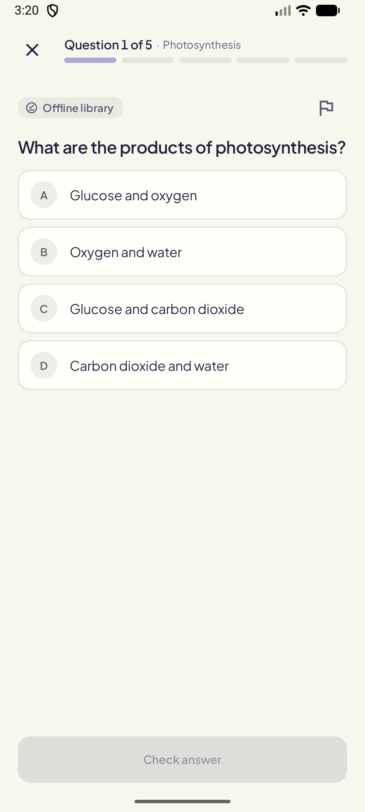
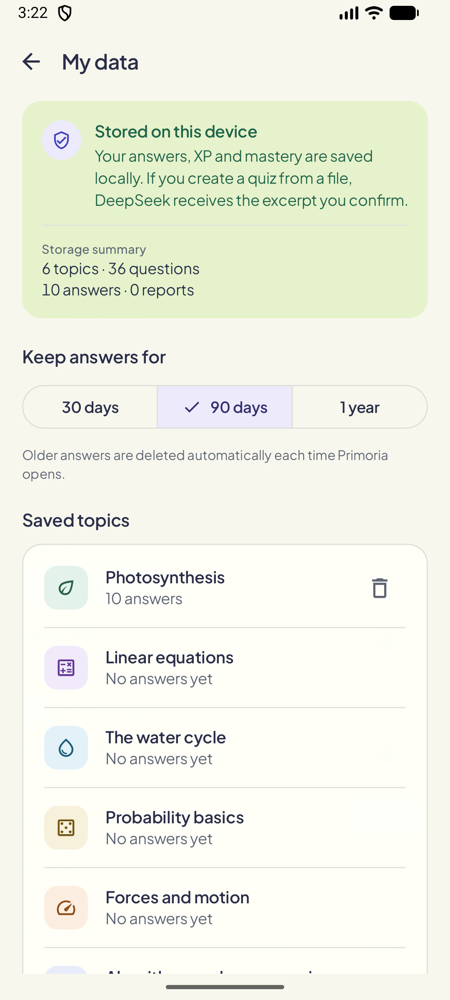
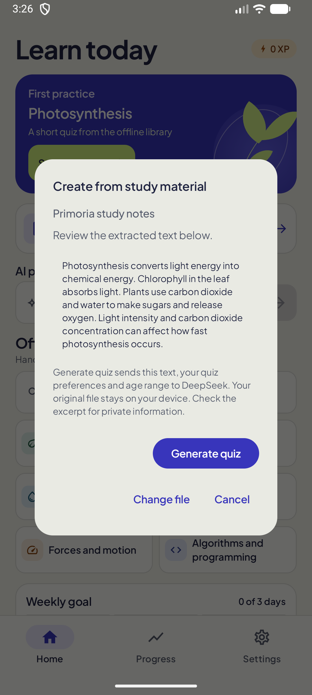
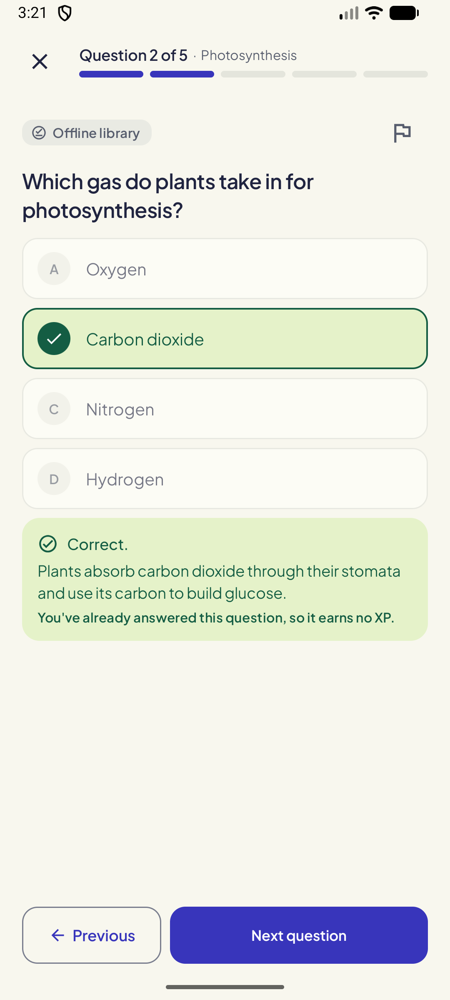
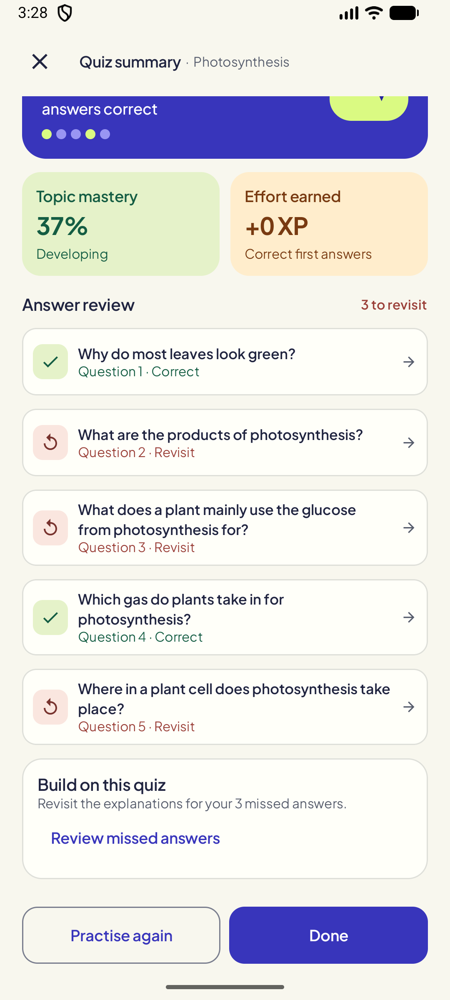
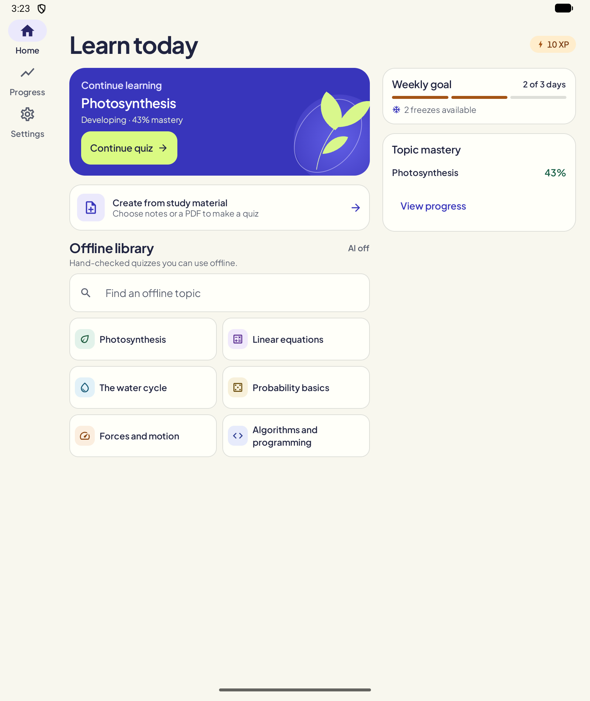

# Primoria for Android

**CP3406 Assessment 3 – Education App** · Kotlin · Jetpack Compose · Material 3 · Hilt · Room · Retrofit · Navigation · DataStore · WorkManager

Primoria is a native Android learning app for **secondary-school students and older learners (13+)**.
Learners practise with the bundled offline library or opt into DeepSeek to generate a short quiz
from a typed topic or a study material excerpt. The app explains checked answers, offers a review of
missed questions and keeps learning history on the device. It presents estimated topic mastery
and XP as separate measures.

It is the Android rebuild of the Primoria web project, designed around the six ethical commitments from my
CP3406 Assessment 2 presentation (*Designing for Trust: learner-data privacy and gamified engagement*).

| Home | Quiz | Feedback | Summary |
|---|---|---|---|
|  |  |  |  |

| Progress | Settings | My data | Onboarding consent (13–17) |
|---|---|---|---|
|  |  |  |  |

| Study material confirmation | Previous question and feedback | Missed-answer review |
|---|---|---|
|  |  |  |

| Dark theme | Dark progress | Tablet (navigation rail and two columns) |
|---|---|---|
|  |  |  |

---

The images above are Android emulator captures. The study material confirmation uses a sample text file.
The review screens show answers and XP from emulator practice sessions.

## Core features

| Screen | What it does |
|---|---|
| **Onboarding** (3 steps) | Welcome, age band (13–17 / 18+), and privacy choices. AI generation is **opt-in** and explained in plain language; learners aged 13–17 also confirm that a parent or guardian knows. |
| **Home** (landing) | The **Learn today** page leads with **Continue quiz** or **Start practice**, offers **Create from study material**, and keeps the six-topic offline library searchable. Learners with AI enabled can also start a quiz from a typed topic. The XP chip links to Progress. |
| **Quiz** (activity) | The learner requests 5 or 10 questions, checks an A–D answer, and sees an explanation with **icon, text and colour** feedback. **Previous** restores checked feedback and unsubmitted choices. The animated summary separates mastery and XP and links to individual explanations or a review of missed answers. AI source labels and the report action remain visible during practice. |
| **Progress** (statistics) | Total XP, today's XP against the daily cap, a 7-day XP bar chart (with a spoken summary for TalkBack), weekly streak, overall accuracy and per-topic mastery (New → Developing → Secure → Mastered). |
| **Settings** | Difficulty, quiz length, weekly goal, sound and vibration, opt-in study reminder with quiet hours, theme (system/light/dark), larger text, AI on/off, age band, optional personal DeepSeek key. |
| **My data** | What is stored (counts), retention period (30 / 90 / 365 days), delete a single topic, or **delete everything** (which also resets onboarding). |

### How learning is measured
* **Mastery** — an exponential moving average per topic (`MasteryCalculator`). Harder questions move it further, and a wrong answer on a hard question costs less than on an easy one, so stretching is not punished. "Mastered" also needs at least 8 answers.
* **XP** — awarded **only for a correct first answer**, scaled by difficulty, and capped at **150 XP a day** (`XpPolicy`). Time spent, app opens and retries earn nothing.
* **Streaks** — count **weeks**, not days: a week counts when the learner studied on their chosen number of days. Two **streak freezes** can bridge missed weeks, and the current week never breaks a streak while it is in progress (`StreakCalculator`).

---

## Ethics in the implementation (from Assessment 2)

| # | A2 commitment | Where it lives in the code |
|---|---|---|
| 01 | **Local-first learner profile** | All history is in Room on the device; `allowBackup="false"` and `data_extraction_rules.xml` exclude it from cloud backup and device transfer; answers expire after the chosen retention period (`DataRetention`, applied on every launch). |
| 02 | **Just-in-time permissions** | The only runtime permission, `POST_NOTIFICATIONS`, is requested **only when the learner switches on study reminders** (`SettingsRoute`). If it is denied, reminders stay off and the app explains why. |
| 03 | **Honest AI** | Every question shows *AI-generated* or *Offline library*; AI explanations carry a note; any question can be **reported** and is then never served again (`content_reports` table, Room v1→v2 migration). DeepSeek may **refuse** unsuitable topics and the reason is shown instead of a quiz. |
| 04 | **Humane streaks** | Weekly goals with freezes, no countdown timers, no loss-framed copy, and an opt-in reminder that is sent **at most once a day, never in quiet hours (default 21:00–07:00), and not at all once the learner has studied today or met the week's goal** (`ReminderPolicy`). |
| 05 | **Reward learning, not screen time** | XP only for verified correct first answers with a daily cap; XP and mastery are always shown in separate cards; answer options are **shuffled** so the correct answer cannot be guessed by position. |
| 06 | **Learner control** | *My data* shows what is stored, lets the learner change retention, delete a topic or delete everything; the age-aware consent flow sets AI to **off** by default for everyone. |

**Data minimisation with DeepSeek.** For a topic quiz, DeepSeek receives the cleaned topic,
difficulty, question count and age band. For a study material quiz, it receives the text excerpt
the learner previews and confirms, along with the same quiz preferences and age band. The original
file and filename stay on the device. Primoria removes common contact details from the text and
asks the learner to check the excerpt for other private information. Scores and learning history
stay on the device.

---

## Visual design

The interface uses a custom Material 3 palette and shared Compose components (see `ui/theme` and `ui/components`).

* **Colour.** A cream background and fine card borders keep the layout quiet. Cobalt marks primary actions. Green marks mastery and correct feedback, amber marks effort and XP, and muted red marks an answer to revisit.
* **Typography.** Plus Jakarta Sans (SIL OFL, bundled in `res/font`, licence in `docs/licenses`) with a compact Material 3 type scale (hierarchy from weight and colour rather than size) and tabular numerals for XP, percentages and counters.
* **Layout and components.** The home screen uses a single high-emphasis practice card, a separate material entry, subject tiles and a weekly goal. Feedback sits under the answer choices. Progress uses separate mastery and effort cards plus a seven-day XP chart. The wide home layout puts practice and the library beside weekly progress and topic mastery.
* **Illustration and motion.** The Home and Welcome artwork is drawn in Compose. Cards use a short press animation. The summary animates the score, emblem and metric cards, then presents the answer list for review.
* **Accessibility.** Feedback uses icons, wording and colour. Options expose result states to TalkBack, the weekly chart exposes a text summary, and the larger-text setting scales on top of the system font size.

The design system was drafted, then revised after a screenshot-based visual review (see *Acknowledgements*) and checked on phone, tablet, light and dark.

---

## Architecture

```
ui/ (Compose screens + ViewModels with observable screen state)
 └─ depends on repository interfaces
data/
 ├─ repository/   LearningRepository · ProgressRepository · PrivacyRepository · OfflineLibrary
 ├─ local/        Room: entities, DAOs, type converters, PrimoriaDatabase (v2, exported schemas)
 ├─ remote/       Retrofit DeepSeekApi · QuizPrompt · QuizResponseParser · AuthInterceptor · Keystore key store
 ├─ settings/     DataStore-backed SettingsRepository
 ├─ reminder/     WorkManager ReminderWorker + ReminderScheduler
 └─ feedback/     SoundEffects (answer tones)
domain/
 ├─ model/        Plain Kotlin models (QuizQuestion, TopicSummary, UserSettings…)
 └─ logic/        Pure rules: MasteryCalculator, XpPolicy, StreakCalculator, ReminderPolicy,
                  OptionShuffler, PersonalDataRedactor, TopicNormalizer, QuietHours, DataRetention
di/               Hilt modules (AppModule, NetworkModule, RepositoryModule)
```

* **MVVM and repositories.** Route composables collect state with `collectAsStateWithLifecycle()` and connect screen actions to ViewModels. `QuizViewModel` holds draft selections and checked answers by question index. Room stores attempts when the learner checks an answer.
* **Dependency injection** with **Hilt**: ViewModels depend on interfaces bound in `RepositoryModule`; tests replace whole modules with `@TestInstallIn`.
* **Pure domain layer**: every learning rule is a side-effect-free Kotlin object, so it is unit-tested on the JVM.

### Navigation
* **Navigation Compose with type-safe `@Serializable` routes** (`Routes.kt`).
* **Nested graphs**: onboarding is separate from `MainGraph`; finishing onboarding pops it off the back stack, and "Delete everything" clears the stack and returns to onboarding.
* **Adaptive top-level navigation**: `NavigationBar` on phones, `NavigationRail` on medium/expanded widths (`WindowSizeClass`), with `saveState`/`restoreState` per tab.
* **Deep link**: `primoria://quiz/{topic}` opens a quiz directly (e.g. `adb shell am start -d "primoria://quiz/Fractions"`).
* **Quiz navigation.** `QuizRoute` can carry the local ID of a saved material quiz. The Previous action restores question state in the same session. Summary review reads the checked answers and returns to the same result. Leaving an in-progress quiz with checked answers asks for confirmation.

### Advanced APIs
* **DeepSeek** (OpenAI-compatible chat completions, JSON mode) via **Retrofit + OkHttp + kotlinx.serialization**. Replies are treated as untrusted: `QuizResponseParser` drops questions without exactly four distinct options, a valid answer index or an explanation.
* **Room** (5 tables, foreign keys with cascade delete, indices, `@Upsert`, `@Transaction`, aggregate queries for daily XP and accuracy, a correlated sub-query that serves questions not yet answered correctly first, an **auto-migration v1→v2**, exported schemas).
* **DataStore** for settings, **Android Keystore** (AES-GCM) for an optional personal API key, **WorkManager** for the opt-in reminder, **SplashScreen** API, and Material 3 dynamic **dark theme** and **larger text**.
* **Study material.** Android's Storage Access Framework opens a selected file. `StudyMaterialReader` extracts text on-device, using PDFBox for PDFs. `HomeViewModel` shows an excerpt before sending it, and `LearningRepository` stores the resulting questions in Room.
* **Offline practice.** Topic quizzes can use bundled or previously saved questions when AI is off, the key is missing or generation fails. Previously generated material quizzes can be reopened from saved questions.

---

## Getting started

1. Open the project in Android Studio (Ladybug or newer), JDK 17, Android SDK 36.
2. *(Optional, for AI quizzes)* copy `.env.example` to `.env` in the project root and add a DeepSeek key:
   ```
   DEEPSEEK_API_KEY=sk-...
   DEEPSEEK_BASE_URL=https://api.deepseek.com/
   DEEPSEEK_MODEL=deepseek-flash
   ```
   `.env` is git-ignored. Without a key the app is still fully usable through the offline library, and a key
   can also be entered at runtime under **Settings › DeepSeek key** (stored encrypted with the Android Keystore).
3. Run the `app` configuration on an emulator or device (minSdk 26).

### Tests

```bash
./gradlew testDebugUnitTest          # JVM unit tests (domain rules, parser, prompt, API, ViewModels)
./gradlew connectedDebugAndroidTest  # Room DAO + migration, repository, Compose UI and Hilt end-to-end tests
```

The latest verification recorded **93 JVM** and **35 Android instrumentation** passes. The device
total includes two temporary acceptance checks used to exercise the Android file picker with a test
DeepSeek response and to capture loading and recovery screens.

| Test suite | What it covers |
|---|---|
| `domain/logic/*Test` | Mastery, XP cap, humane streaks and freezes, quiet hours, reminders, redaction, topic cleaning, retention, option shuffling |
| `data/remote/*Test` | Response validation, refusals, prompt data-minimisation, real HTTP via **MockWebServer** (path, bearer header, JSON mode) |
| `ui/*ViewModelTest` | Quiz state, restored draft and checked choices, single XP award per check, missed-answer review, onboarding consent rules and home input |
| `PrimoriaDaoTest`, `MigrationTest` | Cascades, reported-question exclusion, daily aggregates, retention, v1→v2 migration |
| `LearningRepositoryTest` | AI and offline fallback, refusals, XP, reports, material consent and redaction, omission of the filename from requests, and reopening saved material quizzes offline |
| `StudyMaterialReaderTest` | Local TXT, Markdown and PDF extraction, removal of common contact details, and a PDF with no readable text |
| `ScreenComposeTest` | GUI tests: guardian gate, AI label/report, non-colour feedback semantics, effort/mastery summary, confirm dialogs |
| `AppNavigationTest` | `@HiltAndroidTest` end-to-end: onboarding → AI quiz → summary → Progress; offline library without any DeepSeek call; delete everything → onboarding |

Several bugs were found by these tests during development and are recorded in the commit history
(e.g. freezes wasted on unbridgeable gaps, year ranges redacted as phone numbers, `response_format` never being sent,
and DeepSeek always placing the correct answer first).

---

## Limitations and possible improvements
* The material reader supports files up to 8 MiB and previews up to 12,000 characters drawn from the first 12 pages of a PDF. Image-only PDFs require a text layer. AI question validation checks structure and answer consistency, so subject accuracy still needs review.
* Practice history is built from saved answer attempts. Spaced repetition is a future improvement.
* Reports are stored locally only — there is no moderation back-end to send them to.
* My Assessment 2 recommended that model keys stay on a server (ACS Ethics 2.2(h)). This version has no server, so a developer key from the git-ignored `.env` can be compiled into a **local** build. The submission archive includes `.env.example`. Reviewers can provide their own DeepSeek key to evaluate live generation, and the bundled topics run offline immediately. Learners can use their own Keystore-encrypted key instead, and a production release should route requests through a small server-side proxy.
* The offline library is small (6 topics × 6 questions).

## Acknowledgements and GenAI use
* Quiz content is generated at runtime by **DeepSeek**; the offline library was written and checked by hand.
* Claude Code, OpenAI Codex and Google Gemini assisted with development, tests, design review and documentation.
  Codex also helped implement the approved Android redesign and update this report and reflection. OpenAI ImageGen
  assisted with illustration assets during development. A separate GenAI Use Declaration is required with the assessment.
